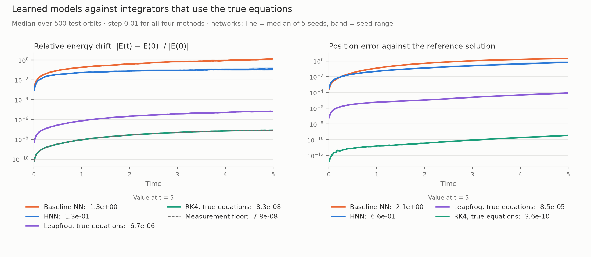
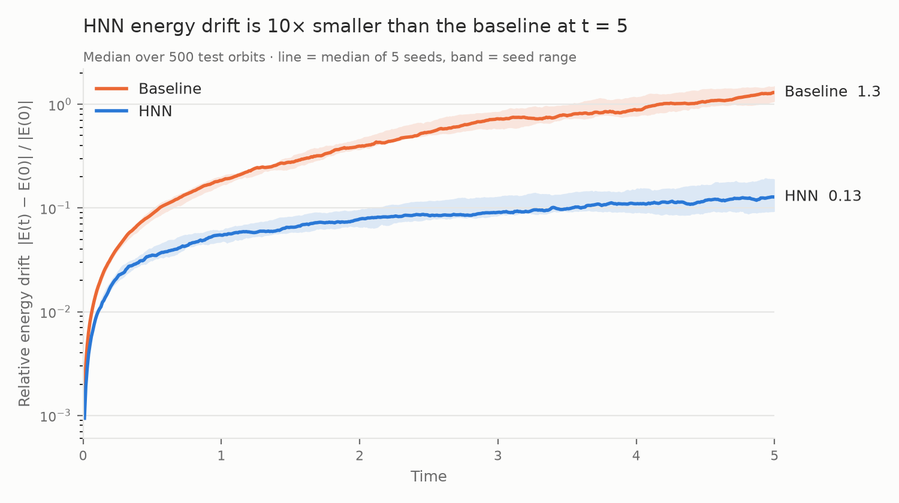

# Hamiltonian Neural Networks for the 3D Three-Body Problem

This project extends Hamiltonian Neural Networks (HNNs) from the original 2D experiments of [Greydanus, Dzamba and Yosinski (2019)](https://arxiv.org/abs/1906.01563) to three gravitating bodies moving in 3D. It compares an HNN with a plain neural network of the same size, and both with standard numerical integrators.

On unseen orbits, over 5 independently trained models of each kind, the HNN predicts the dynamics about **3 times more accurately** than the plain network and conserves energy about **10 times better** over a rollout. Integrators that are given the true equations of motion remain far more accurate than either network.



## Results

All numbers are the mean ± standard deviation over 5 random seeds, measured on test orbits that the models never saw. Rollouts run from $t = 0$ to $t = 5$ with a fixed step of 0.01, for 500 orbits.

| Measure | Baseline NN | HNN | RK4, true equations | Leapfrog, true equations |
|---|---|---|---|---|
| Derivative error (mean squared error) | 0.0523 ± 0.0002 | 0.0170 ± 0.0010 | | |
| Relative energy drift at $t = 5$ (median) | 1.30 ± 0.16 | 0.133 ± 0.037 | $8.3\times10^{-8}$ | $6.7\times10^{-6}$ |
| Position error at $t = 5$ (median) | 2.08 ± 0.08 | 0.72 ± 0.16 | $3.6\times10^{-10}$ | $8.5\times10^{-5}$ |
| Time for 500 rollouts (s) | 0.94 | 1.71 | 0.70 | 0.26 |

- **The HNN beats the plain network on every seed.** Its derivative error is 2.9 to 3.4 times lower, and its energy drift 7 to 12 times lower.
- **Numerical methods win outright.** RK4 and leapfrog know the exact forces, so they are four to nine orders of magnitude more accurate than either network, and no slower. The comparison measures how much accuracy is lost by learning the dynamics from data; the HNN loses much less than the plain network.
- **Neither network handles close encounters.** On test samples with very large forces, which were excluded from training, both networks' errors are about four orders of magnitude larger.

Energy drift is measured against the true energy $E$:

$$
\delta(t) = \frac{\lvert E(t) - E(0)\rvert}{\lvert E(0)\rvert}
$$



## How it works

### The system

Three bodies of unit mass attract each other by gravity ($G = 1$). The state is the position $\mathbf{q}_i$ and momentum $\mathbf{p}_i$ of each body, 18 numbers in total. The total energy, written in terms of these, is the Hamiltonian:

$$
H = \sum_{i=1}^{3} \frac{\lvert\mathbf{p}_i\rvert^2}{2m_i} - \sum_{i<j} \frac{G\, m_i m_j}{\lvert\mathbf{q}_i - \mathbf{q}_j\rvert}
$$

It generates the motion through Hamilton's equations:

$$
\frac{d\mathbf{q}_i}{dt} = \frac{\partial H}{\partial \mathbf{p}_i}, \qquad \frac{d\mathbf{p}_i}{dt} = -\frac{\partial H}{\partial \mathbf{q}_i}
$$

Any motion generated this way conserves $H$ exactly.

### The two models

Both are small fully connected networks (18 inputs, two hidden layers of 200 units, tanh), trained to match the true time derivatives $\dot{\mathbf{x}}$ of the state with a mean-squared-error loss.

- The **baseline** outputs the 18 time derivatives directly. Nothing forces its predictions to conserve energy.
- The **HNN** outputs a single number $H_\theta(\mathbf{x})$, and its prediction is the gradient of that number, rearranged by a fixed matrix $M$ that pairs each position with its momentum:

$$
\hat{\dot{\mathbf{x}}} = \nabla_{\mathbf{x}} H_\theta \, M
$$

Whatever function the HNN learns, the motion it predicts conserves that function. When $H_\theta$ is close to the true energy, the true energy is nearly conserved as well.

### What changed from the original 2D code

- **3D state and symplectic matrix.** The state holds 3D positions and momenta for each body, and $M$ is block-diagonal with one block per body (`hnn3d.py`).
- **Genuinely 3D orbits.** Starting from a near-circular equilateral configuration, each body gets a random velocity kick perpendicular to the orbital plane, so the bodies leave their starting plane, and the whole system is then randomly rotated. Without the kick, three bodies stay in one plane forever.
- **Close encounters filtered out.** Orbits in which any time derivative exceeds 20 are discarded and regenerated, since near-collisions produce forces large enough to dominate training. About 2 to 3% of orbits are affected.
- **Parallel data generation**, and a multi-seed evaluation of derivative error, energy drift and the comparison with numerical methods.

## Repository layout

| Path | Contents |
|---|---|
| `local_3body_notebook.ipynb` | Walkthrough notebook: background, data, training, plots and results |
| `hnn3d.py` | The HNN and baseline models for the 3D system |
| `nn_models.py`, `utils.py` | Network definition and helpers, from the original repository |
| `experiment-3body/3D/data3dcanonical.py` | Orbit generation, physics and dataset building |
| `experiment-3body/3D/make_3d_dataset.py` | Builds and saves the dataset |
| `experiment-3body/3D/train3DtestcodeTesting.py` | Trains one baseline and one HNN |
| `experiment-3body/3D/visuals3dcanonical.py` | Plotting functions used by the notebook |
| `experiment-3body/3D/run_seeds.py` | Trains 5 models of each kind and measures derivative error |
| `experiment-3body/3D/energy_drift.py` | Measures energy drift over rollouts |
| `experiment-3body/3D/compare_methods.py` | Compares the networks with RK4 and leapfrog |
| `experiment-3body/2D/`, `hnn.py` | The original 2D three-body code, kept for reference |

## Running it

Requires Python 3.11. From the repository root, create an environment and install the dependencies:

```bash
python -m venv .venv
```

```bash
pip install -r requirements.txt
```

Activate the environment between those two commands: `.venv\Scripts\Activate.ps1` on Windows, or `source .venv/bin/activate` on macOS and Linux.

The notebook runs everything in order. To run the steps from a terminal instead:

```bash
python experiment-3body/3D/make_3d_dataset.py
```

```bash
python experiment-3body/3D/run_seeds.py --test_trials 2000
```

```bash
python experiment-3body/3D/energy_drift.py
```

```bash
python experiment-3body/3D/compare_methods.py
```

Building the dataset takes about a minute, and training the 10 models in `run_seeds.py` takes 15 to 20 minutes on a laptop CPU. The last two scripts read the saved models and take under a minute each. The amount of out-of-plane motion is set by `OUT_OF_PLANE_NOISE` in `data3dcanonical.py`; the results above use 0.5.

## Limitations

- **Close encounters** were removed from training, and neither network handles them.
- **Absolute accuracy** is limited. By $t = 5$ the HNN's energy is off by about 13% and its body positions by about 0.7, on orbits of radius about 1.
- **Rollouts stop at $t = 5$**, the length of the training orbits.
- **The seeds vary training only.** All seeds share the same training and test data, so the reported spread does not include variation in the data.
- **The size of the HNN's advantage depends on the orbits.** With a smaller out-of-plane kick (0.2), its lead was larger: 3.5 times on derivative error and about 20 times on energy drift.
- **The learned function has the opposite sign to the energy.** With $M$ as defined in `hnn3d.py`, the network learns approximately $-H$. The predicted motion is unaffected.

## Acknowledgements

This repository is a fork of [greydanus/hamiltonian-nn](https://github.com/greydanus/hamiltonian-nn), the code for:

> S. Greydanus, M. Dzamba and J. Yosinski, *Hamiltonian Neural Networks*, Advances in Neural Information Processing Systems 32 (2019). [arXiv:1906.01563](https://arxiv.org/abs/1906.01563)

The network, training loop and 2D three-body code come from that repository. The 3D extension, data generation, evaluation scripts and notebook are new. The original code is released under the Apache License 2.0 (see `LICENSE`), and this fork is distributed under the same licence.
